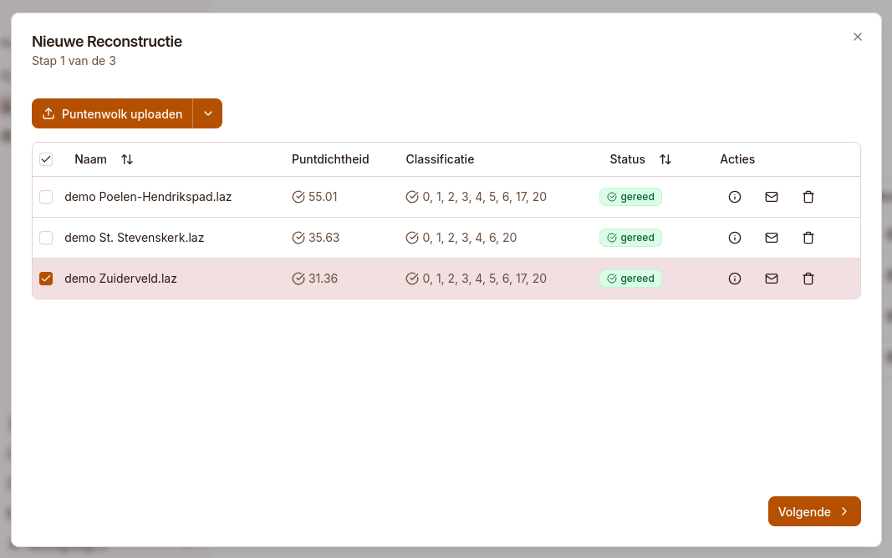
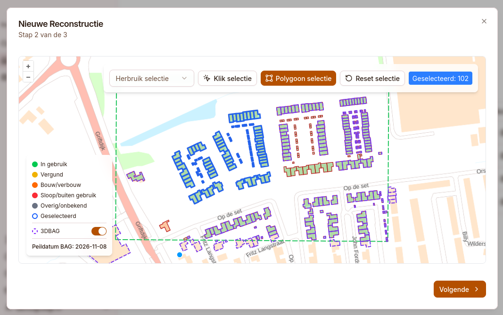
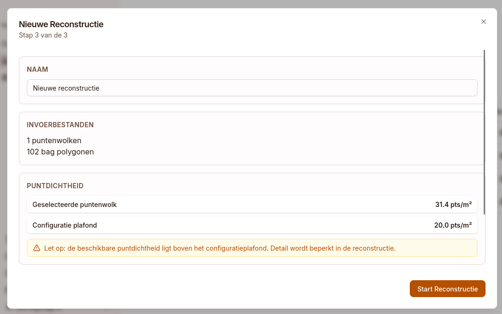
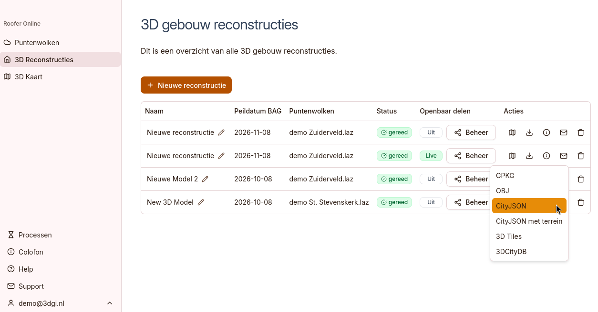

# 3D building reconstruction from point clouds and building polygons with Roofer Online

Geonovum DTaaS Testbed 2026 Phase 2. Adoption topic #1: Implement and validate an OGC API Processes service

## Summary

3DGI added an OGC API – Processes interface to [Roofer Online](https://roofer-online.nl), which reconstructs 3D buildings from point clouds and building footprints. The contribution addresses Topic 1:
exposing an existing calculation module through the nLDT architecture and making it usable by other vendors' clients.

There are two versions of the Roofer Online processes API.

- `v1`: A public demo that was developed for the testbed, and it uses fixture data. Live at [https://processes.staging.roofer-online.nl/ogcapi](https://processes.staging.roofer-online.nl/ogcapi).
    - [process catalogue](https://processes.staging.roofer-online.nl/ogcapi/processes)
    - [Swagger UI](https://processes.staging.roofer-online.nl/ogcapi/docs)
    - [OpenAPI document](https://processes.staging.roofer-online.nl/ogcapi/openapi.json)
- `v2`: The client-facing live Roofer Online processes API, which requires a Roofer Online account and authentication. Live at  [https://roofer-online.nl/ogcapi](https://roofer-online.nl/ogcapi).

|                | v1: public testbed demo                                                       | v2: live Roofer Online API                                                      |
|----------------|-------------------------------------------------------------------------------|---------------------------------------------------------------------------------|
| Purpose        | Let participants test discovery, execution, job handling and process chaining | Run building reconstruction within Roofer Online                                |
| Processing     | Deterministic fixture results and sample CityJSON/GeoPackage files            | Point-cloud ingestion, BAG selection, reconstruction and export                 |
| Access         | Public, no access restriction                                                 | Public discovery; authenticated execution, jobs, results and artifact downloads |
| Processes      | Separate validation, reconstruction and conversion processes                  | One reconstruction process incorporating preparation and requested exports      |
| Execution      | Synchronous and asynchronous                                                  | Asynchronous only                                                               |
| Testbed status | Tested                                                                        | Not tested because authentication is required                                   |

## Roofer Online

[Roofer Online](https://roofer-online.nl) is a web service for creating 3D building models from LAS/LAZ point clouds and BAG building polygons.
Users upload their point clouds, select buildings from BAG data synchronised with Kadaster, and configure reconstruction.
Processing runs on the server, so users do not need to install reconstruction software.
Models can be viewed in 3D, downloaded or published as 3D Tiles.
The main goal of Roofer Online is to enable Dutch municipalities and provinces to generate up-to-date 3D building models from their local point clouds.

The service uses the open-source [Roofer](https://innovation.3dbag.nl/roofer/) reconstruction software, and the same parameters that are used for producing the [3DBAG](https://3dbag.nl).

Roofer Online has a React frontend, a FastAPI backend and a [Dagster](https://dagster.io) processing layer. 
The frontend uses the service's existing internal application API to manage data, start jobs, poll their status and retrieve results. 
A separate authentication handler manages user sign-in. 
The API uses bearer-token authentication with JWT tokens and checks user roles and ownership to control access to processes and assets.
[Dagster]([Dagster](https://dagster.io)) orchestrates point-cloud preparation, BAG synchronisation, reconstruction, format conversion and database export, managing dependencies between processing steps. 
The backend submits jobs through Dagster's GraphQL API and stores process records with their Dagster run identifiers in PostgreSQL. 
When the frontend polls an active process, the backend queries Dagster, updates the stored process and asset statuses, and records output metadata when processing completes. 
This job lifecycle existed before the OGC API interface was added.

A central question for us was how to layer an OGC API – Processes interface over the existing backend API so that external clients could invoke the processes already available through the UI.
The aim was to provide direct, controlled access for automation and integration with other software, while reusing Roofer Online's authentication, ownership checks and job lifecycle.

The Testbed proposal identified four Roofer Online capabilities to expose as OGC API processes:

| Proposed process        | Role in Roofer Online                                                                                                  |
|-------------------------|------------------------------------------------------------------------------------------------------------------------|
| `validate_point_cloud`  | Checks whether a point cloud is suitable for reconstruction, including its spatial extent, classification and density. |
| `reconstruct_buildings` | Reconstructs 3D buildings from the selected BAG polygons and point clouds, producing CityJSON models.                  |
| `convert_format`        | Converts CityJSON models to OBJ, GeoPackage or 3D Tiles for use in other software or publication.                      |
| `export_to_3dcitydb`    | Exports CityJSON models to a 3DCityDB database. *The 3DCityDB export process was not implemented in the testbed.*                                                                       |

*Figure 1. Select an uploaded point cloud after validation.*

*Figure 2. Select BAG buildings within the point-cloud extent, outlined in green.*

*Figure 3. Review the inputs and reconstruction settings before starting the job.*

*Figure 4. Access completed models and choose a download or export format.*

---

## Implementation

### Architecture

### Data

### Processes

### Live API

---

## Conformance

---

## Interoperability with other participants

### Future Insight

### IMAGEM

### Breinstein

---

## Findings

